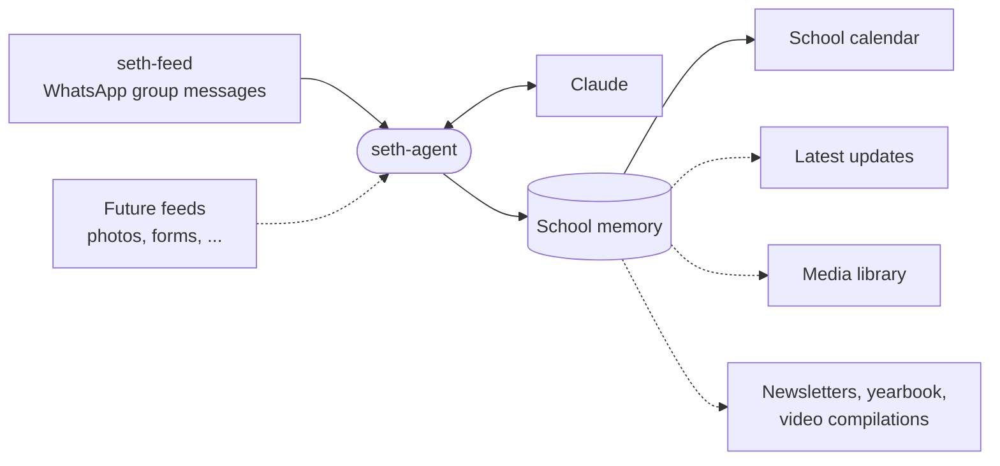

<p align="center">
  <picture>
    <source media="(prefers-color-scheme: dark)" srcset="docs/assets/seth-logo-dark.png">
    
  </picture>
</p>

<h1 align="center">seth-agent</h1>

<p align="center">
  An AI agent that works as the administrator of Seth Christian Education Institute.<br>
  It reads the school's data feeds and keeps the school's calendar, news and media up to date.
</p>

---

A school runs on a constant stream of small facts: a day off, a rescheduled class, a field trip, a new volunteer schedule, a photo from the Christmas program. Most of them are said once, in a chat, and then buried.

seth-agent is the school's administrator, and it doesn't forget. It watches the school's **data feeds**, works out what matters, and keeps the school's key information and assets organized in one place that people and other software can rely on.



Solid lines work today. Dotted lines are planned (see [What's next](#whats-next)).

## What it maintains

| Memory | Status | What it holds |
|---|---|---|
| **School calendar** | Working | Upcoming events, closures, deadlines and schedule changes, picked out of the school's WhatsApp groups |
| **Volunteering calendars** | Working | For each volunteering group, such as the preschool P.E. teachers' parents, who is volunteering when and what it involves |
| **Latest updates** | Planned | The announcements and news worth keeping, in one place |
| **Media library** | Planned | The school's photos and videos, organized so they can be found and reused |

The calendar is the first memory the agent keeps. It reads the messages that [seth-feed](../seth-ingestion) provides from the school's WhatsApp groups, picks out the ones that mention something in the future, and keeps them in a tidy calendar that people or any app can query:

```
2026-10-19   School closed
2026-10-23   Field trip to the science museum
Nov 2026     Parent-teacher conferences (rescheduled)
```

When plans change, the calendar changes with them. *"The field trip is moved to 10/30"* updates the existing event instead of adding a second one, and *"the bake sale is cancelled"* cancels it.

## Contents

- [What it maintains](#what-it-maintains)
- [What's next](#whats-next)
- [How the calendar works](#how-the-calendar-works)
- [Quick start](#quick-start)
- [Volunteering groups](#volunteering-groups)
- [Everyday use](#everyday-use)
- [The dashboard](#the-dashboard)
- [Reading the calendar](#reading-the-calendar)
- [Configuration](#configuration)
- [Troubleshooting](#troubleshooting)
- [Privacy](#privacy)
- [More documentation](#more-documentation)

## What's next

The goal is an agent that holds the school's whole picture, then uses it to do the administrative writing and compiling that staff do by hand today:

- **Weekly newsletters** compiled from the calendar and the latest updates.
- **An annual yearbook** built from the school's photos, with captions drawn from what the agent knows happened.
- **Video compilations** of the year's events, assembled from the media it maintains.

Each new kind of memory is an *extractor* that plugs into the same pipeline, and each new source is a feed. See [Adding a new kind of memory](docs/DEVELOPMENT.md#adding-a-new-kind-of-memory).

## How the calendar works

| A message like… | becomes… |
|---|---|
| "The school is off on Monday" (sent Mon Oct 12) | **2026-10-19**: School closed |
| "Parent-teacher conferences have been rescheduled to Nov" | **Nov 2026**: Parent-teacher conferences (rescheduled) |
| "The field trip is on 10/23" | **2026-10-23**: Field trip |
| "The field trip got moved to 10/30" | the same event, moved to **2026-10-30** |
| "Hello", "I'm outside waiting for you", "Will you be able to make it?" | nothing, because these aren't future events |
| A photo or video with no caption | nothing (the caption is read when there is one) |

Things worth knowing:

- **Dates are read the way a person would.** "Monday", "next week" and "in Nov" are worked out from when the message was **sent**, so an old message means the same thing today as it did then.
- **Rough dates are fine.** An event can be on a day, a range of days, a week, a month or a year.
- **Every event shows where it came from.** You can see the exact messages behind it and every change made to it.
- **It keeps up on its own.** New messages are picked up within about 15 seconds.

## Quick start

You need:

- macOS with [Homebrew](https://brew.sh) Python 3.11 or newer. The system Python is too old.
- [seth-ingestion](../seth-ingestion) set up and capturing the school's WhatsApp messages, with its `seth-feed` API running (`./feed.sh`, default `http://127.0.0.1:8080`).
- An Anthropic API key from the [Claude Console](https://console.anthropic.com), or a model running on this machine (see [Running a local model](#running-a-local-model)).

**1. Install**

```bash
cd seth-agent
/opt/homebrew/bin/python3.14 -m venv .venv
.venv/bin/pip install -e '.[dev]'
```

**2. Add your API key**

```bash
export ANTHROPIC_API_KEY=sk-ant-...
```

To keep it set, add that line to your `~/.zshrc`.

**3. Start it**

```bash
.venv/bin/seth-agent run
```

The first time it runs, the agent reads every message already captured and builds the school calendar from them. After that, it watches for new messages. Leave it running in a terminal tab, and press **Ctrl+C** to stop.

**4. Look at the calendar**

```bash
.venv/bin/seth-agent calendar
```

```
2026-10-19  #1 School closed
2026-10-23  #3 Field trip
               Science museum; the bus leaves at 9am.
Nov 2026    #2 Parent-teacher conferences (rescheduled)
```

## Volunteering groups

Some groups aren't about the school as a whole. In **Preschool P.E. Teachers**, parents arrange who volunteers when and discuss what the volunteering involves. The agent treats a group like that as a *volunteering group*: it reads the group for volunteer sessions and their details, and puts them on that group's own **volunteering calendar**, not the school calendar. The school calendar never sees the group's messages.

| A message in the group like… | becomes… |
|---|---|
| "I can help with P.E. this Thursday, 9 to 10" | **Thursday**, 09:00-10:00: P.E. volunteers, with the parent's name |
| "Sarah's mom is joining Thursday too, bring water bottles" | the same event, with the second volunteer and the water bottles added |
| "Sorry, I can't do Thursday anymore, can someone cover?" | the same event, noting that a cover is needed |
| "It's me this week" (from Alex) | **Friday 11:30**: P.E. volunteer: Alex, because the P.E. class is usually on Fridays at 11:30 |
| "It's Sarah this week" | **Friday 11:30**: P.E. volunteer: Sarah |
| "Thank you everyone!" | nothing |

Parents often just say whose turn it is. The agent works out the rest from the group's name, who sent the message ("me" is the sender), the wording ("this week", "next week") and the group's **usual routine**. For Preschool P.E. Teachers that is Fridays at 11:30am.

**Preschool P.E. Teachers** is the only volunteering group today. To use a different list, set `SETH_VOLUNTEERING_GROUPS` to the group names, separated by semicolons, each with an optional usual routine after an `=` (see [Configuration](#configuration)). Names are matched ignoring capitals and extra spaces. For example:

```bash
SETH_VOLUNTEERING_GROUPS="Preschool P.E. Teachers=The preschool P.E. class is usually on Fridays at 11:30am; Library Helpers=Library help is usually Tuesdays at 9am"
```

Groups are only sorted from now on. Messages the agent has already read stay where they were put. To read a volunteering group's earlier messages onto its calendar, see [Resetting](docs/MEMORY.md#resetting).

## Everyday use

| Command | What it does |
|---|---|
| `seth-agent run` | Keeps watching for new messages and serves the dashboard and the calendar API at `http://127.0.0.1:8765` |
| `seth-agent once` | Catches up on any new messages, prints a summary and exits. Handy for a quick refresh or a scheduled job |
| `seth-agent calendar` | Prints upcoming events, from today onward |
| `seth-agent calendar --from 2026-11-01 --to 2026-11-30` | Prints events in a date range |
| `seth-agent calendar --all` | Also shows cancelled events |
| `seth-agent calendar --group "Preschool P.E. Teachers"` | Prints that volunteering group's calendar instead of the school calendar |

Add `-v` before any command for detailed logs, e.g. `seth-agent -v once`.

All commands live in `.venv/bin/`. To type just `seth-agent`, activate the environment first with `source .venv/bin/activate`.

## The dashboard

While `seth-agent run` is running, open **http://127.0.0.1:8765** in a browser. The dashboard has one tab for each kind of memory the agent maintains. Today there are two: the **School calendar** and **Volunteering**. Each shows a month view of every event, with a list view for small screens. The Volunteering tab has one calendar for each volunteering group, with Preschool P.E. Teachers first. When there is more than one, you pick between them above the calendar. Click an event to see the messages it came from and how it has changed. A badge shows whether the agent is up to date, and the page refreshes itself every few seconds.

It uses the same look as the [seth-ingestion](../seth-ingestion) dashboard. New memories get their own tab, see [Adding a new kind of memory](docs/DEVELOPMENT.md#adding-a-new-kind-of-memory).

## Reading the calendar

While `seth-agent run` is running, any program on the same machine can read the calendar over HTTP:

```bash
curl -s 'http://127.0.0.1:8765/calendar?from=2026-10-01&to=2026-12-31'
```

```json
{
  "from": "2026-10-01",
  "to": "2026-12-31",
  "days": {
    "2026-10-19": [{ "id": 1, "title": "School closed", ... }],
    "2026-10-23": [{ "id": 3, "title": "Field trip", "precision": "day", "date_start": "2026-10-23", "date_end": "2026-10-23", ... }],
    "Nov 2026":   [{ "id": 2, "title": "Parent-teacher conferences (rescheduled)", "precision": "month", "date_start": "2026-11-01", "date_end": "2026-11-30", ... }]
  },
  "events": [ ... ]
}
```

Volunteering groups have their own calendars. `/volunteering` lists them, and `/calendar?group=` reads one:

```bash
curl -s 'http://127.0.0.1:8765/volunteering'
curl -s 'http://127.0.0.1:8765/calendar?group=Preschool%20P.E.%20Teachers'
```

To see why an event exists, ask for it by id. The response includes the messages behind it and its full change history:

```bash
curl -s http://127.0.0.1:8765/events/3
```

To check the agent is healthy:

```bash
curl -s http://127.0.0.1:8765/health
```

You can also open **http://127.0.0.1:8765/docs** in a browser to try every endpoint interactively. The complete reference is in [docs/API.md](docs/API.md).

## Configuration

The defaults match a standard setup, so most people won't need to change anything. To change a setting, set an environment variable before running:

| Variable | Default | What it controls |
|---|---|---|
| `SETH_PROVIDER` | `anthropic` | Who reads the messages: `anthropic` (Claude) or `local` (a model on this machine) |
| `ANTHROPIC_API_KEY` | (none) | The Claude API key. **Required** when the provider is `anthropic` |
| `SETH_FEED_URL` | `http://127.0.0.1:8080` | Where seth-ingestion's `seth-feed` API is running |
| `SETH_MEMORY_DB` | `./data/memory.db` | Where the calendar is kept |
| `SETH_POLL_SECONDS` | `15` | How often to check for new messages |
| `SETH_TZ` | the machine's timezone | Timezone for working out dates, e.g. `America/Los_Angeles` |
| `SETH_MODEL` | `claude-opus-5-5` | The Claude model that reads the messages (provider `anthropic`) |
| `SETH_EFFORT` | `medium` | How carefully Claude thinks: `low` is cheaper and faster, `high` is more careful with tricky dates (provider `anthropic`) |
| `SETH_LOCAL_URL` | `http://127.0.0.1:11434/v1` | The local model server's OpenAI-compatible address (provider `local`). The default is Ollama |
| `SETH_LOCAL_MODEL` | `qwen3:30b-a3b` | The model name as the local server knows it (provider `local`) |
| `SETH_LOCAL_API_KEY` | (none) | Only if your local server requires a key |
| `SETH_LOCAL_TIMEOUT` | `600` | Seconds to wait for the local model to answer one batch |
| `SETH_BATCH_SIZE` | `20` | Messages per request to the model. Lower it (say `8`) for a local model |
| `SETH_VOLUNTEERING_GROUPS` | `Preschool P.E. Teachers=The preschool P.E. class is usually on Fridays at 11:30am.` | WhatsApp groups to treat as volunteering groups, as `Name=usual routine` entries separated by `;`. The routine is optional. Setting it replaces the default (so include Preschool P.E. Teachers and its routine if you still want them); set it empty for none |
| `SETH_API_HOST` / `SETH_API_PORT` | `127.0.0.1` / `8765` | Where the HTTP API listens |

Example:

```bash
SETH_POLL_SECONDS=60 SETH_EFFORT=low .venv/bin/seth-agent run
```

## Running a local model

Instead of Claude, the agent can use a model running on the same machine, so no message text leaves it. Any server with an OpenAI-compatible `/chat/completions` endpoint works: [Ollama](https://ollama.com), LM Studio, `mlx-lm` or llama.cpp. For a 64 GB Mac, a Qwen3 model in the 30B class at 4-bit is a good place to start.

```bash
ollama pull qwen3:30b-a3b
SETH_PROVIDER=local SETH_LOCAL_MODEL=qwen3:30b-a3b SETH_BATCH_SIZE=8 .venv/bin/seth-agent run
```

For another server, set `SETH_LOCAL_URL` (LM Studio's is `http://127.0.0.1:1234/v1`) and `SETH_LOCAL_MODEL`.

Local models read dates and decide between "new event" and "update" less reliably than Claude. Before relying on one, run the live checks against it and compare with Claude's results:

```bash
SETH_PROVIDER=local SETH_LOCAL_MODEL=qwen3:30b-a3b .venv/bin/python evals/calendar_examples.py
SETH_PROVIDER=local SETH_LOCAL_MODEL=qwen3:30b-a3b .venv/bin/python evals/volunteering_examples.py
```

The provider is chosen for the whole agent. Switching it doesn't redo old messages: they stay processed.

## Troubleshooting

**"no Anthropic credentials: set ANTHROPIC_API_KEY"**
The agent can't reach Claude without a key. Set `ANTHROPIC_API_KEY` and start it again. Nothing is lost: the waiting messages are processed as soon as the key works.

**"local model server unreachable" or "404" with `SETH_PROVIDER=local`**
The server isn't running at `SETH_LOCAL_URL`, or it doesn't have the model named in `SETH_LOCAL_MODEL` (with Ollama: `ollama pull <name>`). Nothing is lost: the batch is retried as soon as the server answers.

**The calendar is empty**
- Run `seth-agent -v once` and read the summary. `0 candidates` means seth-ingestion hasn't captured any messages yet.
- Remember that most messages aren't events. Greetings, questions and photos without captions are skipped on purpose.
- `seth-agent calendar` only shows events from today onward. Use `--from` to look further back.

**An event has the wrong date or shouldn't be there**
Open `http://127.0.0.1:8765/events/<id>` to see which messages it came from. If Claude often misreads the school's messages, try `SETH_EFFORT=high`. If the date depends on context the agent doesn't have, it can only go by what the messages say.

**"seth-feed unavailable, will retry"**
The agent can't reach `seth-feed`. Start it from seth-ingestion (`./feed.sh`, or from its dashboard) and check that `SETH_FEED_URL` matches its address. Nothing is lost: the agent carries on from where it stopped as soon as the feed answers.

**Port 8765 is already in use**
Another copy of the agent may already be running. Stop it, or choose a different port with `SETH_API_PORT=8766`.

**Start over from scratch**
Stop the agent and delete `data/memory.db`. The next run rebuilds the calendar from every captured message. This makes one Claude request per 20 or so messages.

## Privacy

The school's chats contain messages from parents, students and staff, so the agent is built to keep that data close:

- **Everything stays on the machine it runs on**, except the message text sent to Claude to read. With `SETH_PROVIDER=local`, nothing leaves it at all.
- **Media files aren't sent.** Only text and captions are.
- **The API listens only on the local machine** (`127.0.0.1`), so other devices on the network can't reach it. It has no authentication, so don't expose it more widely without adding some.
- **The agent never changes seth-ingestion's data.** It only reads it, through the read-only `seth-feed` API.
- The school's memory is a single SQLite file in `data/`, which git ignores.
- **Messages are treated as data, never as instructions.** Text from the groups can't tell the agent to change how it works.

## More documentation

| Document | For |
|---|---|
| [docs/API.md](docs/API.md) | Building an app or a tool on top of the school calendar: every endpoint, field and status code |
| [docs/MEMORY.md](docs/MEMORY.md) | How the memory database is laid out, with ready-to-run SQL queries |
| [docs/DEVELOPMENT.md](docs/DEVELOPMENT.md) | Working on the agent: architecture, how extraction works, testing, and adding new kinds of memory |
