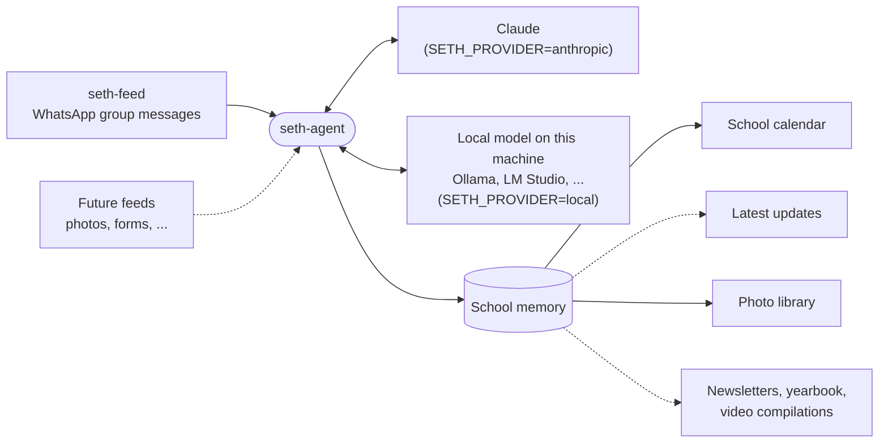

<p align="center">
  <picture>
    <source media="(prefers-color-scheme: dark)" srcset="brand/logos/logo-dark.png">
    
  </picture>
</p>

<h1 align="center">seth-agent</h1>

<p align="center">
  An AI agent that works as the administrator of Seth Christian Education Institute.<br>
  It reads the school's data feeds and keeps the school's calendar, news and media up to date.
</p>

---

A school runs on a constant stream of small facts: a day off, a rescheduled class, a field trip, a new volunteer schedule, a photo from the Christmas program. Most of them are said once, in a chat, and then buried.

seth-agent is the school's administrator, and it doesn't forget. It watches the school's **data feeds**, works out what matters, and keeps the school's key information and assets organized in one place that people and other software can rely on.



The agent reads the messages with either Claude or a model running on the same machine, whichever `SETH_PROVIDER` selects (see [Running a local model](#running-a-local-model)). Solid lines work today. Dotted lines are planned (see [What's next](#whats-next)).

## What it maintains

| Memory | Status | What it holds |
|---|---|---|
| **School calendar** | Working | Upcoming events, closures, deadlines and schedule changes, picked out of the school's WhatsApp groups |
| **Volunteering calendars** | Working | For each volunteering group, such as the preschool P.E. teachers' parents, who is volunteering when and what it involves |
| **Latest updates** | Planned | The announcements and news worth keeping, in one place |
| **Photo library** | Working | The school's photos, searchable by describing them ("children eating meals"), across all groups or within one, such as Preschool. See [Photo search](#photo-search) |
| **Slideshow videos** | Working | Videos made from photos you choose, or that the agent finds from a sentence about the event, in the school's branding. See [Slideshow videos](#slideshow-videos) |
| **Video library** | Planned | The school's videos, organized so they can be found and reused |

The calendar is the first memory the agent keeps. It reads the messages that [seth-feed](../seth-ingestion) provides from the school's WhatsApp groups, picks out the ones that mention something in the future, and keeps them in a tidy calendar that people or any app can query:

```
2026-10-19   School closed
2026-10-23   Field trip to the science museum
Nov 2026     Parent-teacher conferences (rescheduled)
```

When plans change, the calendar changes with them. *"The field trip is moved to 10/30"* updates the existing event instead of adding a second one, and *"the bake sale is cancelled"* cancels it.

## Contents

- [What it maintains](#what-it-maintains)
- [What's next](#whats-next)
- [How the calendar works](#how-the-calendar-works)
- [Quick start](#quick-start)
- [Volunteering groups](#volunteering-groups)
- [Everyday use](#everyday-use)
- [The dashboard](#the-dashboard)
- [Reading the calendar](#reading-the-calendar)
- [Photo search](#photo-search)
- [Flyers](#flyers)
- [Slideshow videos](#slideshow-videos)
- [Configuration](#configuration)
- [Troubleshooting](#troubleshooting)
- [Privacy](#privacy)
- [More documentation](#more-documentation)

## What's next

The goal is an agent that holds the school's whole picture, then uses it to do the administrative writing and compiling that staff do by hand today:

- **Flyers** in the school's branding, made from a sentence. Working today (see [Flyers](#flyers)), with photos from the school's library, a fresh design every time, and, if an image provider is set up, generated artwork.
- **Weekly newsletters** compiled from the calendar and the latest updates.
- **An annual yearbook** built from the school's photos, with captions drawn from what the agent knows happened.
- **Video compilations** of the year's events. Slideshows work today, with photos you choose or that the agent finds for an event (see [Slideshow videos](#slideshow-videos)); including video clips is still to come.

Each new kind of memory is an *extractor* that plugs into the same pipeline, and each new source is a feed. See [Adding a new kind of memory](docs/DEVELOPMENT.md#adding-a-new-kind-of-memory).

## How the calendar works

| A message like… | becomes… |
|---|---|
| "The school is off on Monday" (sent Mon Oct 12) | **2026-10-19**: School closed |
| "Parent-teacher conferences have been rescheduled to Nov" | **Nov 2026**: Parent-teacher conferences (rescheduled) |
| "The field trip is on 10/23" | **2026-10-23**: Field trip |
| "The field trip got moved to 10/30" | the same event, moved to **2026-10-30** |
| "Hello", "I'm outside waiting for you", "Will you be able to make it?" | nothing, because these aren't future events |
| A photo or video with no caption | nothing (the caption is read when there is one) |

Things worth knowing:

- **Dates are read the way a person would.** "Monday", "next week" and "in Nov" are worked out from when the message was **sent**, so an old message means the same thing today as it did then.
- **Rough dates are fine.** An event can be on a day, a range of days, a week, a month or a year.
- **Every event shows where it came from.** You can see the exact messages behind it and every change made to it.
- **It keeps up on its own.** New messages are picked up within about 15 seconds.

## Quick start

You need:

- macOS with [Homebrew](https://brew.sh) Python 3.11 or newer. The system Python is too old.
- [seth-ingestion](../seth-ingestion) set up and capturing the school's WhatsApp messages, with its `seth-feed` API running (`./feed.sh`, default `http://127.0.0.1:8080`).
- A Mac with about 64 GB of memory, to run the local model with [Ollama](https://ollama.com). This quick start has the agent read the messages with a model on this machine, so no message text leaves it. (To use Claude instead, see [Using Claude instead](#using-claude-instead).)

**1. Install**

```bash
cd seth-agent
/opt/homebrew/bin/python3.14 -m venv .venv
.venv/bin/pip install -e '.[dev]'
```

**2. Set up the local model**

```bash
brew install ollama
brew services start ollama
ollama pull gemma4:31b
```

The model is about 19 GB. Then give it a longer context window. Ollama silently cuts off whatever doesn't fit its default window, and the agent would never see the newest messages. Create a file named `Modelfile` with:

```
FROM gemma4:31b
PARAMETER num_ctx 32768
PARAMETER temperature 0
```

and build a named copy of the model. It shares the downloaded weights, so it takes no extra disk space:

```bash
ollama create seth-reader -f Modelfile
```

Tell the agent to use it. To keep these set, add the lines to your `~/.zshrc`:

```bash
export SETH_PROVIDER=local
export SETH_LOCAL_MODEL=seth-reader
export SETH_BATCH_SIZE=8
```

Step by step, with how to keep the model loaded and check that it runs on the GPU, in [docs/OLLAMA_SETUP.md](docs/OLLAMA_SETUP.md).

**3. Start it**

```bash
.venv/bin/seth-agent run
```

The first time it runs, the agent reads every message already captured and builds the school calendar from them. With a local model that can take a while. After that, it watches for new messages. Leave it running in a terminal tab, and press **Ctrl+C** to stop.

**4. Look at the calendar**

```bash
.venv/bin/seth-agent calendar
```

```
2026-10-19  #1 School closed
2026-10-23  #3 Field trip
               Science museum; the bus leaves at 9am.
Nov 2026    #2 Parent-teacher conferences (rescheduled)
```

### Using Claude instead

To have Claude read the messages, use an API key from the [Claude Console](https://console.anthropic.com) instead of step 2. Only the message text is sent to Claude.

```bash
export SETH_PROVIDER=anthropic
export ANTHROPIC_API_KEY=sk-ant-...
```

## Volunteering groups

Some groups aren't about the school as a whole. In **Preschool P.E. Teachers**, parents arrange who volunteers when and discuss what the volunteering involves. The agent treats a group like that as a *volunteering group*: it reads the group for volunteer sessions and their details, and puts them on that group's own **volunteering calendar**, not the school calendar. The school calendar never sees the group's messages.

| A message in the group like… | becomes… |
|---|---|
| "I can help with P.E. this Thursday, 9 to 10" | **Thursday**, 09:00-10:00: P.E. volunteers, with the parent's name |
| "Sarah's mom is joining Thursday too, bring water bottles" | the same event, with the second volunteer and the water bottles added |
| "Sorry, I can't do Thursday anymore, can someone cover?" | the same event, noting that a cover is needed |
| "It's me this week" (from Alex) | **Friday 11:30**: P.E. volunteer: Alex, because the P.E. class is usually on Fridays at 11:30 |
| "It's Sarah this week" | **Friday 11:30**: P.E. volunteer: Sarah |
| "Thank you everyone!" | nothing |

Parents often just say whose turn it is. The agent works out the rest from the group's name, who sent the message ("me" is the sender), the wording ("this week", "next week") and the group's **usual routine**. For Preschool P.E. Teachers that is Fridays at 11:30am.

**Preschool P.E. Teachers** is the only volunteering group today. To use a different list, set `SETH_VOLUNTEERING_GROUPS` to the group names, separated by semicolons, each with an optional usual routine after an `=` (see [Configuration](#configuration)). Names are matched ignoring capitals and extra spaces. For example:

```bash
SETH_VOLUNTEERING_GROUPS="Preschool P.E. Teachers=The preschool P.E. class is usually on Fridays at 11:30am; Library Helpers=Library help is usually Tuesdays at 9am"
```

Groups are only sorted from now on. Messages the agent has already read stay where they were put. To read a volunteering group's earlier messages onto its calendar, see [Resetting](docs/MEMORY.md#resetting).

## Everyday use

| Command | What it does |
|---|---|
| `seth-agent run` | Keeps watching for new messages and serves the dashboard and the calendar API at `http://127.0.0.1:8765` |
| `seth-agent once` | Catches up on any new messages, prints a summary and exits. Handy for a quick refresh or a scheduled job |
| `seth-agent calendar` | Prints upcoming events, from today onward |
| `seth-agent calendar --from 2026-11-01 --to 2026-11-30` | Prints events in a date range |
| `seth-agent calendar --all` | Also shows cancelled events |
| `seth-agent calendar --group "Preschool P.E. Teachers"` | Prints that volunteering group's calendar instead of the school calendar |
| `seth-agent photos "children eating meals" --group Preschool` | Finds photos by describing them (`--group` is optional). Needs [photo search](#photo-search) |
| `seth-agent flyer "Open House on 11/7/2026 at 10am - 12pm"` | Makes a flyer in the school's branding and saves it as a PNG. See [Flyers](#flyers) |
| `seth-agent slideshow "Christmas Program" --photo 48 --photo 60` | Makes a slideshow video from the photos you choose, in the school's branding (`--find` instead of `--photo` finds an event's photos itself). See [Slideshow videos](#slideshow-videos) |

Add `-v` before any command for detailed logs, e.g. `seth-agent -v once`.

All commands live in `.venv/bin/`. To type just `seth-agent`, activate the environment first with `source .venv/bin/activate`.

## The dashboard

While `seth-agent run` is running, open **http://127.0.0.1:8765** in a browser. The dashboard opens on **Status**, which shows whether the agent is up to date and a **Metrics** section: how long it has been running, how many messages each part has read, the events on each calendar, and for photo search, how many photos are indexed and searchable, the model, the storage the embeddings take, which groups the photos come from and how many searches have been answered. After that comes one tab for each kind of memory the agent maintains. Today there are three: the **School calendar**, **Volunteering** and **Media**. Each shows a month view of every event, with a list view for small screens. The Volunteering tab has one calendar for each volunteering group, with Preschool P.E. Teachers first. When there is more than one, you pick between them above the calendar. Click an event to see the messages it came from and how it has changed. The Media tab has two parts. **Generate slideshow video**: describe an event in a sentence ("Christmas Program on 12/12/2026 at school"), press **Generate video**, and the agent finds the photos and makes the video, as `seth-agent slideshow --find` does (see [Slideshow videos](#slideshow-videos)). It takes a minute or two and you can leave the page open; when it is ready you can watch it there, see what the agent understood and which photos it used, and press **Download video**. The page keeps the last ten videos. **Find photos** is a photo search: type what the photos show, pick a group (Preschool by default, or all groups) and press **Search** to see the best matches as a grid of thumbnails. Click one to enlarge it. A badge shows whether the agent is up to date, and the page refreshes itself every few seconds.

It uses the same look as the [seth-ingestion](../seth-ingestion) dashboard. New memories get their own tab, see [Adding a new kind of memory](docs/DEVELOPMENT.md#adding-a-new-kind-of-memory).

## Reading the calendar

While `seth-agent run` is running, any program on the same machine can read the calendar over HTTP:

```bash
curl -s 'http://127.0.0.1:8765/calendar?from=2026-10-01&to=2026-12-31'
```

```json
{
  "from": "2026-10-01",
  "to": "2026-12-31",
  "days": {
    "2026-10-19": [{ "id": 1, "title": "School closed", ... }],
    "2026-10-23": [{ "id": 3, "title": "Field trip", "precision": "day", "date_start": "2026-10-23", "date_end": "2026-10-23", ... }],
    "Nov 2026":   [{ "id": 2, "title": "Parent-teacher conferences (rescheduled)", "precision": "month", "date_start": "2026-11-01", "date_end": "2026-11-30", ... }]
  },
  "events": [ ... ]
}
```

Volunteering groups have their own calendars. `/volunteering` lists them, and `/calendar?group=` reads one:

```bash
curl -s 'http://127.0.0.1:8765/volunteering'
curl -s 'http://127.0.0.1:8765/calendar?group=Preschool%20P.E.%20Teachers'
```

To see why an event exists, ask for it by id. The response includes the messages behind it and its full change history:

```bash
curl -s http://127.0.0.1:8765/events/3
```

To check the agent is healthy:

```bash
curl -s http://127.0.0.1:8765/health
```

You can also open **http://127.0.0.1:8765/docs** in a browser to try every endpoint interactively. The complete reference is in [docs/API.md](docs/API.md).

## Photo search

The agent indexes the photos in the school's groups so they can be found by describing them. A model that runs on this machine (CLIP) turns each photo, and each search, into numbers that can be compared, so *"children on a soccer field"* finds photos of that even if nobody captioned them. No photo leaves the machine, and no language model is involved.

Install the extra libraries once (a few GB, mostly PyTorch). The photo model, about 600 MB, downloads the first time the agent runs:

```bash
.venv/bin/pip install -e '.[dev,media]'
```

With them installed, `seth-agent run` indexes new photos as they arrive, along with the calendars. Photos sent before this was installed are indexed once you tell the agent to read the history again (see [Resetting](docs/MEMORY.md#resetting)). Without the extra libraries the agent runs as before, without photo search. Set `SETH_MEDIA_INDEX=0` to turn it off.

A search is a query and, optionally, the group to look in. The group is its own field, so the agent never has to guess it from your sentence:

```bash
curl -s http://127.0.0.1:8765/media/search -H 'Content-Type: application/json' \
  -d '{"query": "children sitting at table", "group": "Preschool"}'

curl -s http://127.0.0.1:8765/media/search -H 'Content-Type: application/json' \
  -d '{"query": "children eating meals"}'
```

The second has no `group`, so it searches every group. The group must be the group's exact name (case and extra spaces don't matter): "Preschool" and "Preschool P.E. Teachers" are different groups, and a name that matches neither gets a `404` that lists the real ones. Each result has the photo's group, sender, time and caption, a `score`, and a `url` for the picture. The fields are in [docs/API.md](docs/API.md#post-mediasearch).

From a terminal:

```bash
.venv/bin/seth-agent photos "children on a soccer field" --group Preschool
.venv/bin/seth-agent photos "children eating meals" --limit 5
```

Good to know:

- A search always returns the best photos it has, even when none is a good match. The `score` tells them apart, and `min_score` drops weak ones.
- It finds what a photo looks like. It can't read writing in a photo or tell which child is which.
- Only photos are indexed, not videos.

## Flyers

Describe an event in a sentence and the agent makes a flyer for it in the school's branding:

```bash
.venv/bin/seth-agent flyer "Open House on 11/7/2026 at 10am - 12pm"
```

```
Read from your request: Open House | Saturday, November 7, 2026 | 10:00 AM – 12:00 PM
data/flyers/2026-10-17-open-house-on-11-7-2026-at-10am-12pm.png
```

The flyer is a 1080 × 1350 PNG, a shape that shows whole in WhatsApp and on phones. The line it prints first is what the agent understood, so check the date and time before you share the flyer. Dates are read US style (11/7 is November 7), and a day with no year means its next coming. Use `-o file.png` to choose where it is saved.

How it is made matters, because a wrong date on a flyer is worse than a plain flyer:

1. The model (Claude or the local one, whichever `SETH_PROVIDER` selects) reads the request into a few fields: the event's name, date, start and end time, place, and any other details. It only uses what you wrote, and leaves out the rest.
2. The page is designed (see [Design](#design)) from the [brand kit](brand/README.md): the real logo file, the school's colors, its font and art kit, the school's slogan, and the navy, green and gold stripe. The date and time are written by the program from the structured fields, so they are spelled the same way every time. So is the school's address, which is printed when people are meant to come to the school (an open house, picture day) and left off when the event is somewhere else or nobody needs to come. Check the first line the command prints: it ends with "school address" when the address was added. Add `--address` or `--no-address` to decide yourself.
3. Chrome draws the page to a PNG. This needs Google Chrome (or Chromium or Edge) on the machine, and nothing else to install.

### Design

**Every flyer is designed from scratch.** The model (Claude or the local one) writes the page itself as HTML and CSS, with its own SVG drawings, so an open house, a picnic and a picture day don't look alike. Each time it is pointed at two random looks (a poster, a scrapbook, a chalkboard, an invitation card, bunting and balloons, a calendar page, and so on) and told to adapt them. You can steer it:

```bash
.venv/bin/seth-agent flyer "Spring Picnic on 4/17/2027 from 11am to 2pm at Baylands Park" --idea "like a gingham picnic blanket"
```

It builds the page from the school's **art kit**: [brand/motifs/](brand/motifs), 16 hand-drawn motifs in the school's palette (bunting, balloons, sun, hills, tree, schoolhouse, flowers, butterflies, crayons, leaves, ribbons, sparkles, clouds, books). They give even a modest model something finished to compose with, and it can add its own SVG on top. This is also the answer to flyers without an image provider: no key is needed for good-looking artwork.

**The model never types the facts.** It writes tokens such as `{{TITLE}}`, `{{DATE}}`, `{{ADDRESS}}`, `{{LOGO}}` and `{{PHOTO_1}}`, and the program swaps in the exact words and the real image files. So the page can't misspell a date, redraw the logo or invent a detail. Before a page is accepted, the program checks it, and a page that breaks the rules is sent back with the problems listed (up to three times):

- it must use every word and picture the flyer has (including its photos), show the logo and the slogan, and have background artwork, and print no words that don't come from the request (only the labels "When" and "Where");
- it may not load anything from outside or run scripts, and may use only the school's colors and font;
- Chrome draws it, and it is refused if any text runs off the page, overlaps other text or is covered by a picture, if text is tiny, or if the logo or a photo is too small or has something painted over it.

If the model can't make a page that passes, the flyer is made with the standard layout instead, and the command says why.

How long it takes depends on the model. A model on this machine needs to think to lay a page out, so expect up to about ten minutes with its revisions (Claude should be much quicker, though that hasn't been timed here; `SETH_DESIGN_EFFORT` and `SETH_DESIGN_MAX_TOKENS` control that; the local default is `low` and 40000). For an instant flyer, pick a fixed layout from [brand/templates](brand/templates) with `--layout event` or `--layout event-collage`.

You can also design a flyer yourself, or have Claude Code do it, and run it through the same rules with `--design-file page.html`. The page uses the same tokens (the full list is printed in [design.py](src/seth_agent/flyer/design.py)), and the command refuses it, saying why, if it breaks a rule.

### Photos

**A flyer gets photos from the school's photo library when that is possible and appropriate.** The model describes what kind of photo would suit the event ("children in a classroom", "children playing outside"), and the same CLIP search that powers [photo search](#photo-search) finds up to three. Photos that look alike (burst shots, or one sent to two groups) are only used once, and only photos that match well enough are used, so a flyer may get fewer than three. The model also decides when photos are *not* appropriate, and leaves them off a closure, a cancellation, a deadline or payment reminder, a weather or safety notice, or anything sad or serious. And if the photo library isn't available, or nothing in it matches, the flyer is made without photos and the command says so.

```
Photo #48: Preschool, 2026-10-05 (score 0.31)
Photo #60: Preschool, 2026-10-04 (score 0.31)
Photo #35: Preschool, 2026-10-07 (score 0.30)
```

- **Photos come from every group by default.** To limit them to one group, set `SETH_FLYER_PHOTO_GROUP` to its exact name, or use `--photo-group "Preschool"` for one flyer (`--photo-group all` goes back to every group).
- **The command lists the photos it used.** Look at them before you share the flyer, because the pictures show children. To swap one, find the photo you want in the dashboard's Media tab and use its id: `--photo 48 --photo 12` (a photo you pick is used as it is, with no search, and it is an error if it can't be used). `--no-photos` leaves photos off a flyer, and `--photos 2` asks for fewer or more (1 to 6).
- Photos are turned upright and shrunk to fit the page. The originals are never changed.
- Photos go into the design as a token each (`{{PHOTO_1}}`, ...), which the designer must use, unaltered and clear of other pictures. `--layout event` or `--layout event-collage` use a fixed layout instead of a designed one.

### Always on every flyer

Whatever the event, and whether the page is designed, uses a fixed layout or comes from `--design-file`, every flyer has:

- the school's real **logo**, at a readable size and with nothing painted over it;
- the school's **slogan**, word for word;
- the school's **colors and font** only (the designer is refused if it uses any other hex color, color name or font);
- the school's **address** when the event is at the school;
- a **background of artwork**, never a bare page. With no image provider it is a scene composed from the school's [art kit](brand/motifs): autumn leaves for Thanksgiving, crayons for picture day, bunting and balloons for a party, spring flowers, a sunny schoolyard otherwise, picked from the event's wording and the season. Generated artwork or your own picture (`--art-file`) replaces it, and if generated artwork fails the scene stands in.

### Artwork

Without an image provider the flyer is clean and plain. With one, an image model paints a background picture that suits the event (an open door and an oak tree for an open house, say), in the school's palette and a fixed picture-book style written in the `art` section of [brand.json](brand/brand.json). The picture never carries words, so every word and number on the flyer is still written by the program. A soft cream veil keeps the text easy to read over it.

```bash
export SETH_IMAGE_PROVIDER=openai
export OPENAI_API_KEY=sk-...
.venv/bin/seth-agent flyer "Open House on 11/7/2026 at 10am - 12pm"
```

```
Read from your request: Open House | Saturday, November 7, 2026 | 10:00 AM – 12:00 PM
Artwork: data/flyers/2026-10-17-open-house-on-11-7-2026-at-10am-12pm-art.png  (reuse it with --art-file)
data/flyers/2026-10-17-open-house-on-11-7-2026-at-10am-12pm.png
```

- **Each flyer's picture is made fresh, and OpenAI bills for each one.** The picture is saved next to the flyer. To change the wording and keep the picture, run the command again with `--art-file` pointing at it: that makes no new picture and costs nothing. `--art-file` also takes any picture of your own, such as a photo from the school's library.
- **If the picture can't be made** (the service is down, or it refuses the request), the flyer is still made without it, and the command says why.
- `--no-art` makes a plain flyer even when a provider is set up.
- Only the event's name, tagline and extra details go to the image provider, as a short description of a scene. The date, time and place don't, and neither do the school's messages.
- Any server that copies OpenAI's images API works: set `SETH_IMAGE_URL` to its address. A model running on this machine behind such a server would keep everything local.

To change how the pictures look, edit the `art` section of [brand/brand.json](brand/brand.json). It is added to every picture request word for word.

The layout is [brand/templates/event.html](brand/templates/event.html). To change how flyers look, edit it and look at the result with the command above.

## Slideshow videos

Give the agent photos from the library, or just the event, and it makes a slideshow video in the school's branding. Two ways to choose the photos:

### Let the agent find the photos

```bash
.venv/bin/seth-agent slideshow "Christmas Program on 12/12/2026 at school" --find
```

```
Read from your request: Christmas Program | Saturday, December 12, 2026 | school address
Looked for: children singing on a stage / families gathered in a room / children in costumes
Photos sent 2026-12-11 to 2026-12-15.
Photo #48: Preschool, 2026-12-12, score 0.31
...
12 photos, 58 seconds. Watch it before you share it: the photos show children.
data/slideshows/2026-10-17-christmas-program.mp4
```

Write the event the way you would for a [flyer](#flyers). The model reads it into the event's name, its date and whether it is at the school, and describes the kinds of photo an album of that event would hold. Then the same CLIP search as [photo search](#photo-search) does the finding:

- **The date limits the search.** When the sentence has a date, only photos sent from the day before to three days after it are looked through, so last year's Christmas program can't turn up. If nothing in that window matches, the command says so. Leave the date out of the sentence to look through every photo.
- **The video follows the day.** The photos are shown in the order they were sent, not best match first. Burst shots and a photo sent to two groups are used once, and only photos that match well enough are used, so you can get fewer than `--count` (default 12; 2 to 40).
- **The title, the date line and the address come from the sentence.** The date line under the title is the event's date, and the closing card carries the school's address when it is an event at the school. Say `--subtitle "..."`, `--address` or `--no-address` to decide yourself.
- **Check what it understood.** The command prints what it read and what it looked for first, then each photo it used. To drop or reorder one, list the photos you want with `--photo` (below).
- **On the dashboard** the same thing is the Media tab's *Generate slideshow video* box (see [The dashboard](#the-dashboard)). Videos made there are saved in `SETH_SLIDESHOW_DIR` too, but the dashboard keeps only the last ten, deleting older ones, and forgets them when the agent restarts.
- Photos come from every group by default; limit them with `--photo-group "Preschool"` or `SETH_FLYER_PHOTO_GROUP` (the dashboard uses `SETH_FLYER_PHOTO_GROUP`). This needs [photo search](#photo-search) turned on and the model set up, as for flyers; it uses Claude or the local model for two short questions and the photos never leave this machine.

### Choose the photos yourself

```bash
.venv/bin/seth-agent slideshow "Christmas Program 2026" --photo 48 --photo 60 --photo 35 \
  --subtitle "December 12, 2026" --end-text "Thank you for a wonderful year!" --address --music carols.mp3
```

```
Photo #48: Preschool, 2026-10-05
Photo #60: Preschool, 2026-10-04
Photo #35: Preschool, 2026-10-07
3 photos, 22 seconds. Watch it before you share it: the photos show children.
data/slideshows/2026-10-17-christmas-program-2026.mp4
```

The video is 1920 × 1080 (landscape) MP4, with:

1. a **title card** with the logo, your title and, under it, your subtitle (such as the date);
2. each **photo**, in the order you gave them, shown whole over a soft blur of itself so any shape of photo fills the screen, drifting in slowly and dissolving into the next;
3. a **closing card** with the logo for dark backgrounds, your closing line if you gave one, and the school's address if you add `--address` (use it for events held at the school).

Every page carries the school's slogan and the navy, green and gold stripe. The slogan, logo and address come from the [brand kit](brand/README.md), and with `--photo` no model is involved: the title, subtitle and closing line are exactly what you typed. It costs nothing to make one.

- **With `--photo` you choose the photos by id.** Find them in the dashboard's Media tab, or with `seth-agent photos "children on stage"`. The ids come out in the order you give them, so `--photo 48 --photo 60` shows 48 first. A photo that isn't in the library is an error.
- `--seconds 7` sets how long each photo is shown (2 to 20, default 5). The title and closing cards are 4 seconds each.
- `--music file` plays any audio file ffmpeg can read under the video, faded in and out and cut to its length (it loops if the video is longer). Use music you have the right to use.
- `-o file.mp4` chooses where it is saved; the default is `data/slideshows/`.
- This needs **Google Chrome** (it draws the pages, as it does for flyers) and **ffmpeg**: on a Mac, `brew install ffmpeg`.
- **Watch the video before you share it.** The photos show children, and the agent can't tell which ones are fine to share.

Not yet: captions on each photo, portrait (phone-shaped) videos, and video clips.

## Configuration

The defaults match a standard setup, so most people won't need to change anything. To change a setting, set an environment variable before running:

| Variable | Default | What it controls |
|---|---|---|
| `SETH_PROVIDER` | `anthropic` | Who reads the messages: `anthropic` (Claude) or `local` (a model on this machine) |
| `ANTHROPIC_API_KEY` | (none) | The Claude API key. **Required** when the provider is `anthropic` |
| `SETH_FEED_URL` | `http://127.0.0.1:8080` | Where seth-ingestion's `seth-feed` API is running |
| `SETH_MEMORY_DB` | `./data/memory.db` | Where the calendar is kept |
| `SETH_POLL_SECONDS` | `15` | How often to check for new messages |
| `SETH_TZ` | the machine's timezone | Timezone for working out dates, e.g. `America/Los_Angeles` |
| `SETH_MODEL` | `claude-opus-5-5` | The Claude model that reads the messages (provider `anthropic`) |
| `SETH_EFFORT` | `medium` | How carefully Claude thinks: `low` is cheaper and faster, `high` is more careful with tricky dates (provider `anthropic`) |
| `SETH_LOCAL_URL` | `http://127.0.0.1:11434/v1` | The local model server's OpenAI-compatible address (provider `local`). The default is Ollama |
| `SETH_LOCAL_MODEL` | `gemma4:31b` | The model name as the local server knows it (provider `local`) |
| `SETH_LOCAL_API_KEY` | (none) | Only if your local server requires a key |
| `SETH_LOCAL_TIMEOUT` | `600` | Seconds to wait for the local model to answer one batch |
| `SETH_LOCAL_MAX_TOKENS` | `16000` | The most the local model may write for one batch, thinking included. A model that reasons at length can hit this before it answers, which fails the batch ("hit max_tokens before finishing"). Raise it if you see that |
| `SETH_BATCH_SIZE` | `20` | Messages per request to the model. Lower it (say `8`) for a local model |
| `SETH_VOLUNTEERING_GROUPS` | `Preschool P.E. Teachers=The preschool P.E. class is usually on Fridays at 11:30am.` | WhatsApp groups to treat as volunteering groups, as `Name=usual routine` entries separated by `;`. The routine is optional. Setting it replaces the default (so include Preschool P.E. Teachers and its routine if you still want them); set it empty for none |
| `SETH_MEDIA_INDEX` | `1` | Index photos for [photo search](#photo-search) when the `media` extra is installed. `0` turns it off |
| `SETH_MEDIA_MODEL` | `openai/clip-vit-base-patch16` | The CLIP model that describes photos and searches (a Hugging Face name). Changing it means indexing the photos again |
| `SETH_BRAND_DIR` | `brand/` in this repo | The [brand kit](brand/README.md) that flyers are made from |
| `SETH_FLYER_DIR` | `data/flyers/` | Where `seth-agent flyer` saves its PNGs |
| `SETH_CHROME` | (found automatically) | The Chrome, Chromium or Edge that draws flyers and slideshow pages, if it isn't in the usual place |
| `SETH_SLIDESHOW_DIR` | `data/slideshows/` | Where `seth-agent slideshow` saves its MP4s |
| `SETH_FFMPEG` | (found automatically) | The ffmpeg that makes slideshow videos, if it isn't on the path |
| `SETH_FLYER_PHOTO_GROUP` | `all` | The group [flyer photos](#photos) come from, by its exact name. `all` (or empty) means every group |
| `SETH_FLYER_PHOTO_MIN_SCORE` | `0.25` | How well a photo must match the event to be used (CLIP similarity, about 0.3 for a good match and 0.2 for an unrelated photo). Raise it for fewer, better photos |
| `SETH_DESIGN_EFFORT` | `low` (local), the model's default (Claude) | How hard the model thinks while designing a flyer: `none`, `low`, `medium` or `high`. A local model needs some thinking to lay a page out |
| `SETH_DESIGN_MAX_TOKENS` | `40000` (local), `24000` (Claude) | The most the model may write, thinking included, for one design |
| `SETH_IMAGE_PROVIDER` | `none` | Where flyer [artwork](#artwork) comes from: `none` (plain flyers) or `openai` |
| `OPENAI_API_KEY` | (none) | The key for the image provider. `SETH_IMAGE_API_KEY` is used instead if set |
| `SETH_IMAGE_MODEL` | `gpt-image-1` | The image model. Check the provider's current model names and prices before changing it |
| `SETH_IMAGE_QUALITY` / `SETH_IMAGE_SIZE` | `high` / `1024x1536` | Picture quality (lower is cheaper) and size (portrait) |
| `SETH_IMAGE_URL` | `https://api.openai.com/v1` | Address of the image server, for any server that copies OpenAI's images API |
| `SETH_API_HOST` / `SETH_API_PORT` | `127.0.0.1` / `8765` | Where the HTTP API listens |

Example:

```bash
SETH_POLL_SECONDS=60 SETH_EFFORT=low .venv/bin/seth-agent run
```

## Running a local model

Instead of Claude, the agent can use a model running on the same machine, so no message text leaves it. Any server with an OpenAI-compatible `/chat/completions` endpoint works: [Ollama](https://ollama.com), LM Studio, `mlx-lm` or llama.cpp. For a 64 GB Mac, `gemma4:31b` (the default) passed every check in the evals, ahead of the Qwen3 models. The full walkthrough is in [docs/OLLAMA_SETUP.md](docs/OLLAMA_SETUP.md), and the reasoning behind the model choice in [docs/LOCAL_MODEL_CHOICE.md](docs/LOCAL_MODEL_CHOICE.md).

```bash
ollama pull gemma4:31b
SETH_PROVIDER=local SETH_LOCAL_MODEL=gemma4:31b SETH_BATCH_SIZE=8 .venv/bin/seth-agent run
```

For another server, set `SETH_LOCAL_URL` (LM Studio's is `http://127.0.0.1:1234/v1`) and `SETH_LOCAL_MODEL`.

Local models read dates and decide between "new event" and "update" less reliably than Claude. Before relying on one, run the live checks against it and compare with Claude's results:

```bash
SETH_PROVIDER=local SETH_LOCAL_MODEL=gemma4:31b .venv/bin/python evals/calendar_examples.py
SETH_PROVIDER=local SETH_LOCAL_MODEL=gemma4:31b .venv/bin/python evals/volunteering_examples.py
SETH_PROVIDER=local SETH_LOCAL_MODEL=gemma4:31b .venv/bin/python evals/bilingual_examples.py
```

The third one (Chinese and mixed messages, repeats across groups, prompt injection) is the hardest, and the best test of a model.

The provider is chosen for the whole agent. Switching it doesn't redo old messages: they stay processed.

## Troubleshooting

**"no Anthropic credentials: set ANTHROPIC_API_KEY"**
The agent can't reach Claude without a key. Set `ANTHROPIC_API_KEY` and start it again. Nothing is lost: the waiting messages are processed as soon as the key works.

**"local model server unreachable" or "404" with `SETH_PROVIDER=local`**
The server isn't running at `SETH_LOCAL_URL`, or it doesn't have the model named in `SETH_LOCAL_MODEL` (with Ollama: `ollama pull <name>`). Nothing is lost: the batch is retried as soon as the server answers.

**The calendar is empty**
- Run `seth-agent -v once` and read the summary. `0 candidates` means seth-ingestion hasn't captured any messages yet.
- Remember that most messages aren't events. Greetings, questions and photos without captions are skipped on purpose.
- `seth-agent calendar` only shows events from today onward. Use `--from` to look further back.

**An event has the wrong date or shouldn't be there**
Open `http://127.0.0.1:8765/events/<id>` to see which messages it came from. If Claude often misreads the school's messages, try `SETH_EFFORT=high`. If the date depends on context the agent doesn't have, it can only go by what the messages say.

**"seth-feed unavailable, will retry"**
The agent can't reach `seth-feed`. Start it from seth-ingestion (`./feed.sh`, or from its dashboard) and check that `SETH_FEED_URL` matches its address. Nothing is lost: the agent carries on from where it stopped as soon as the feed answers.

**Port 8765 is already in use**
Another copy of the agent may already be running. Stop it, or choose a different port with `SETH_API_PORT=8766`.

**Start over from scratch**
Stop the agent and delete `data/memory.db`. The next run rebuilds the calendar from every captured message. This makes one Claude request per 20 or so messages.

## Privacy

The school's chats contain messages from parents, students and staff, so the agent is built to keep that data close:

- **Everything stays on the machine it runs on**, except the message text sent to Claude to read. With `SETH_PROVIDER=local`, nothing leaves it at all.
- **Flyer artwork is the one other thing that leaves the machine, and only if you turn it on.** With `SETH_IMAGE_PROVIDER=openai`, a flyer's name, tagline and extra details are sent to OpenAI to paint a background. Nothing from the chats is.
- **Flyers use the school's photos when they suit, and a flyer is meant to be shared.** Photos can come from any group, and the command lists exactly which ones (with their group), so you can check before sharing. Limit them to one group with `SETH_FLYER_PHOTO_GROUP`.
- **Media files aren't sent.** Only text and captions are. Photos are read by a model on this machine for [photo search](#photo-search), whichever `SETH_PROVIDER` you use.
- **The API listens only on the local machine** (`127.0.0.1`), so other devices on the network can't reach it. It has no authentication, so don't expose it more widely without adding some.
- **The agent never changes seth-ingestion's data.** It only reads it, through the read-only `seth-feed` API.
- The school's memory is a single SQLite file in `data/`, which git ignores.
- **Messages are treated as data, never as instructions.** Text from the groups can't tell the agent to change how it works.

## More documentation

| Document | For |
|---|---|
| [docs/API.md](docs/API.md) | Building an app or a tool on top of the school calendar: every endpoint, field and status code |
| [docs/MEMORY.md](docs/MEMORY.md) | How the memory database is laid out, with ready-to-run SQL queries |
| [docs/DEVELOPMENT.md](docs/DEVELOPMENT.md) | Working on the agent: architecture, how extraction works, testing, and adding new kinds of memory |
| [docs/OLLAMA_SETUP.md](docs/OLLAMA_SETUP.md) | Running a local model with Ollama on a Mac, step by step |
| [docs/LOCAL_MODEL_CHOICE.md](docs/LOCAL_MODEL_CHOICE.md) | Which local models to try, the reasoning behind the shortlist, and how to decide between them |
