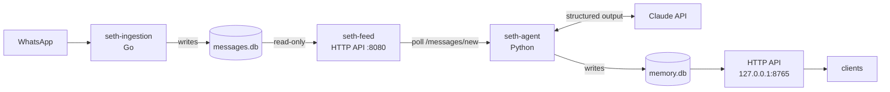
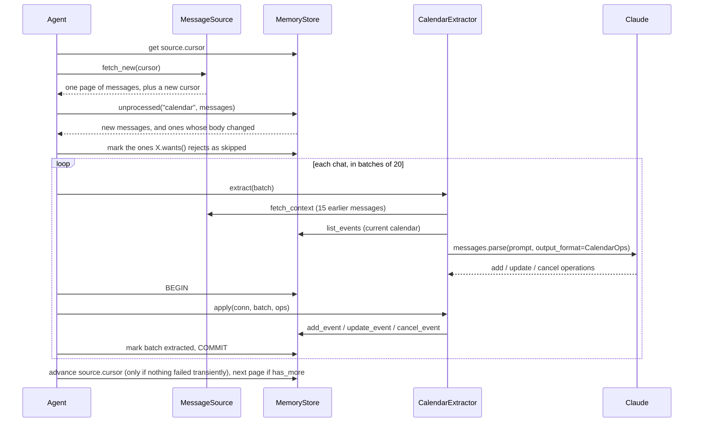

# Development guide

seth-agent is an AI agent that acts as the administrator of Seth Christian Education Institute. It consumes data feeds, such as seth-feed's WhatsApp messages, and maintains the school's key information and assets. Today that is the school calendar. Latest updates and a media library come next, and later newsletters, a yearbook and video compilations built on top of them.

This guide is for working on seth-agent itself. To install and run it, see the [README](../README.md). The memory database is described in [MEMORY.md](MEMORY.md), and the HTTP API in [API.md](API.md).

## Contents

- [The big picture](#the-big-picture)
- [Layout](#layout)
- [How a message becomes an event](#how-a-message-becomes-an-event)
- [The calendar extractor](#the-calendar-extractor)
- [Errors and retries](#errors-and-retries)
- [Concurrency](#concurrency)
- [Setting up and testing](#setting-up-and-testing)
- [Adding a new kind of memory](#adding-a-new-kind-of-memory)
- [Design decisions](#design-decisions)
- [Known limitations](#known-limitations)

## The big picture

seth-agent consumes data feeds and turns them into school memory. Today there is one feed, seth-feed, which carries the school's WhatsApp group messages, so the pipeline is two processes:



The two processes share nothing but seth-feed's read-only HTTP API (see seth-ingestion's `docs/CONSUMING.md`). seth-agent never opens `messages.db`. Either one can be stopped, restarted or upgraded without the other noticing. When seth-agent comes back, it catches up from where it left off.

Inside seth-agent, `seth-agent run` runs one process with two threads:

- the **poller** (`Agent.run_forever`) reads new messages, hands them to the extractors, and writes memory;
- the **API server** (uvicorn and FastAPI) serves reads from memory.

## Layout

```
src/seth_agent/
├── cli.py                 Entry point: `seth-agent run | once | calendar`
├── config.py              Settings from SETH_* environment variables
├── source.py              MessageSource: read-only client for seth-ingestion's seth-feed HTTP API
├── agent.py               Agent: the poll loop, batching, transactions, high-water mark
├── api.py                 FastAPI app: /calendar, /events/{id}, /health, and the dashboard at /
├── dashboard/             The dashboard: one static index.html (no build step) and the Seth logos
├── extractors/
│   ├── base.py            Extractor interface, TransientError, PermanentError
│   └── calendar.py        CalendarExtractor: prompt, Claude call, applying operations
└── memory/
    ├── schema.sql         Memory database schema (idempotent)
    └── store.py           MemoryStore: all reads and writes to memory.db
tests/
├── conftest.py            Fixtures: a fake seth-feed (fakefeed.py), a temp memory.db
├── fakefeed.py            In-memory stand-in for seth-feed behind an httpx MockTransport
├── test_source.py         Reading seth-feed: cursor paging, groups, edits, replies, albums, errors
├── test_store.py          Date spans, overlap queries, updates, cancels, history
├── test_agent.py          The poll loop and extractor, with Claude replaced by scripted responses
└── test_api.py            HTTP responses
evals/
└── calendar_examples.py   Live check against Claude using the examples from the spec
```

Each module has one job, and only `MemoryStore` writes to memory.db.

## How a message becomes an event

One call to `Agent.poll_once()`:



Step by step:

1. **Read a page.** `MessageSource.fetch_new` calls seth-feed's `GET /messages/new?since=<cursor>` and gets up to 500 messages, oldest-arrived first (the agent sorts them by `sent_at`), with a new cursor. Each message carries its group (`group`, with `chat_jid` as the group's JID) and its latest text. Edits arrive as their own `edit` rows, and an album that gained a caption or photos is sent again (`updated: true`). Edit rows come with the original message's text (`edit_target_body`), and replies come with the quoted text (`quoted_body`), looked up with `GET /messages/{chat_jid}/{message_id}` when the target isn't in the page. The cursor is stored only after the page is fully handled, and the agent keeps reading pages while `has_more` is true.
2. **Deduplicate.** `MemoryStore.unprocessed` drops messages the extractor has already handled with the same body hash. A message can be delivered more than once (an album sent again, or a page retried after a transient error), and this step keeps that harmless.
3. **Filter.** `Extractor.wants` is a cheap, local check. Rejected messages are marked `skipped` straight away.
4. **Batch.** The remaining messages are grouped by WhatsApp group, so each prompt covers one conversation, and split into batches of `batch_size`.
5. **Extract.** `Extractor.extract` does the slow work (the Claude call) **outside** any transaction, so the database is never locked during a network request.
6. **Apply and mark.** `Extractor.apply` and `MemoryStore.mark_processed` run in **one transaction**. A crash between the Claude call and the commit means the batch is processed again next time. It never ends up half-applied.
7. **Advance the high-water mark,** but only if no extractor hit a transient error. Otherwise a batch waiting to be retried could fall outside the 10-minute window.

`seth-agent once` runs this once. `seth-agent run` repeats it every `SETH_POLL_SECONDS`.

## The calendar extractor

[extractors/calendar.py](../src/seth_agent/extractors/calendar.py) is where the work happens.

### Filtering

`wants()` passes a message to Claude only if it has a body (text, or a media caption) and at least one letter or digit. This excludes media without captions, reactions, locations and emoji-only replies. The type isn't checked: seth-ingestion sometimes labels ordinary text as `other`. There is deliberately no keyword filter: phrasings like "we're off Monday" or "moved to Nov" are too varied for keywords to catch reliably, and the community's message volume is low.

### The prompt

The **system prompt** (`SYSTEM_PROMPT`) is fixed. It explains:

- what counts as a future event and what doesn't, with the examples from the spec;
- how to resolve dates;
- how to keep the calendar consistent (update or cancel rather than duplicate);
- how to write titles.

The **user message** is built fresh for each batch by `build_prompt`:

```
The messages are from Alex Doe to the user.
<calendar>
id=3 | 2026-10-18 (day) | Dad's flight | from messages: M4
</calendar>
<earlier_messages>
[Mon 2026-10-12 10:00 PDT] id=M1 type=text: Hello
…
</earlier_messages>
<new_messages>
[Mon 2026-10-12 10:30 PDT] id=M7 type=text: Oh wait, dad's flight got moved to 10/20
</new_messages>
```

Each part of the user message has a job:

- **The local sent time, with the weekday,** lets Claude resolve "Monday" or "tomorrow" against when the message was written. Without the weekday, models often get weekday arithmetic wrong.
- **The calendar** lists active events from 7 days before the batch's earliest message onward, plus any older events linked to a message being edited or replied to. This is what lets Claude say "update event 3" instead of adding a duplicate.
- **The earlier messages** (the 15 before the batch) give context for things like "yes, that day works". The prompt tells Claude not to create events from them alone, because they've already been processed.
- **Edits** show the original text and point at the message they replace. **Replies** show the quoted text.

### The output

The output is structured: `client.beta.messages.parse(output_format=CalendarOps)` constrains Claude to the Pydantic schema, and the SDK validates the response:

```python
class EventOp(BaseModel):
    op: Literal["add", "update", "cancel"]
    event_id: int | None          # required for update/cancel
    title, details, date_start, date_end, precision, time, confidence, reason
    source_message_ids: list[str]

class CalendarOps(BaseModel):
    operations: list[EventOp]
```

`EventOp` is deliberately one flat model, not a union of three types. A flat schema is simpler for structured outputs, and `apply()` checks which fields each operation needs.

### Applying operations

`apply()` maps `source_message_ids` back to `(chat_jid, message_id)` keys. Unknown ids are ignored, and if none remain, the whole batch is used as the source. It then calls the matching `MemoryStore` method. An operation that fails validation (an add with no date, an update to a nonexistent id) is logged and skipped, and the rest of the batch still applies.

### Model settings

| Setting | Value | Why |
|---|---|---|
| Model | `claude-opus-5-5` (`SETH_MODEL`) | Best at date reasoning and following instructions |
| Thinking | adaptive (the model default) | Date arithmetic benefits from a moment of reasoning |
| Effort | `medium` (`SETH_EFFORT`) | Enough for date resolution. Raise it if you see mistakes |
| `max_tokens` | 16000 | Plenty of room for a batch's operations plus thinking |
| Refusal fallback | `fallbacks: "default"` (beta `server-side-fallback-2026-07-01`) | If the model declines, the API retries on a fallback model within the same call |

## Errors and retries

Every failure falls into one of two kinds, defined in [extractors/base.py](../src/seth_agent/extractors/base.py):

| Kind | Examples | What happens |
|---|---|---|
| `TransientError` | no API key, 401/403/404, 408/409/429, any 5xx, network errors, timeouts | The batch stays unprocessed and the high-water mark stays put. The poll loop backs off exponentially, from `SETH_POLL_SECONDS` up to 10 minutes, and resets after a successful poll |
| `PermanentError` | 400 or 422, a refusal (even after the fallback), `max_tokens` reached, unparseable output | The batch is recorded in `extraction_errors`, marked `failed`, and the loop moves on |

Configuration problems such as 401 (bad key) and 404 (unknown model) count as transient on purpose. A mistake in your setup shouldn't permanently mark every message as failed. The agent waits for you to fix it.

The SDK itself already retries 429, 5xx and connection errors twice before seth-agent sees them.

## Concurrency

- **memory.db** runs in WAL mode, so the API's reads never block the poller's writes. `MemoryStore` opens a short-lived connection for each operation, so neither thread shares a connection with the other.
- **seth-feed** is only ever called with `GET`. If it's unreachable or returns an error, `MessageSource` raises `SourceError`; `Agent.poll_once` treats that as a transient error, leaves the cursor where it was and retries with backoff.
- **Connections are always closed** with `contextlib.closing`. A `with sqlite3.connect(...)` block on its own only commits, and leaves the connection open.

## Setting up and testing

```bash
/opt/homebrew/bin/python3.14 -m venv .venv
.venv/bin/pip install -e '.[dev]'

.venv/bin/pytest                   # ~1 second, no network, no API key needed
.venv/bin/pytest -k album -v       # a single test
```

How the tests are set up:

- **Fake feed.** `tests/fakefeed.py` implements the parts of seth-feed the agent uses (`/health`, `/messages`, `/messages/new`, `/messages/{chat_jid}/{message_id}`) in memory, including edits, albums sent again and an outage switch. If seth-feed's behaviour changes (see its `docs/CONSUMING.md`), update it to match.
- **No Claude.** `test_agent.py` subclasses `CalendarExtractor` as `ScriptedCalendar`, replacing `extract()` with a function that returns canned `CalendarOps`. The prompt is still built, so tests can check what Claude would see (`ext.prompts`).

### The live eval

`evals/calendar_examples.py` puts the example messages from the original spec into a temporary database, sends them through the real extractor, then sends a follow-up ("dad's flight got moved to 10/20") and checks the results:

```bash
ANTHROPIC_API_KEY=... .venv/bin/python evals/calendar_examples.py
```

```
  #3 2026-10-20   active    Dad's flight  (sources: ['M4', 'M7'])
  …
PASS  school off -> 2026-10-19
PASS  workout -> Nov 2026 (month)
PASS  dad's flight moved -> 2026-10-20
PASS  flight updated, not duplicated
PASS  no events from M1/M5/M6
PASS  exactly 3 active events
```

It makes two Claude calls. Run it after changing the prompt, the schema of `EventOp`, the model or the effort level. When you find a message the agent gets wrong, add it here as a new check.

### Trying it against real data without touching your calendar

Point the memory database somewhere temporary:

```bash
SETH_MEMORY_DB=/tmp/scratch-memory.db .venv/bin/seth-agent -v once
SETH_MEMORY_DB=/tmp/scratch-memory.db .venv/bin/seth-agent calendar --from 2020-01-01
```

To see the exact prompt for the messages that are waiting:

```python
from seth_agent.config import Config
from seth_agent.agent import build_agent

agent = build_agent(Config.from_env())
ext = agent.extractors[0]
pending = [m for m in agent.store.unprocessed(ext.name, agent.source.fetch_new(None).messages) if ext.wants(m)]
print(ext.build_prompt(pending[:20]))
```

## Adding a new kind of memory

The calendar is the first **extractor**. Each future kind of memory (the latest school updates, the media library, people and places) is another extractor that works the same way. Here's the whole recipe, using a hypothetical "school updates" memory (*"The library is getting new shelves"*, *"Mrs. Lee is joining the choir"*) as the example.

**1. Add its tables** to [memory/schema.sql](../src/seth_agent/memory/schema.sql):

```sql
CREATE TABLE IF NOT EXISTS updates (
    id         INTEGER PRIMARY KEY,
    topic      TEXT NOT NULL,
    summary    TEXT NOT NULL,
    happened   TEXT,                    -- YYYY-MM-DD if known
    created_at TEXT NOT NULL
);
CREATE TABLE IF NOT EXISTS update_sources (
    update_id  INTEGER NOT NULL REFERENCES updates (id) ON DELETE CASCADE,
    chat_jid   TEXT NOT NULL,
    message_id TEXT NOT NULL,
    PRIMARY KEY (update_id, chat_jid, message_id)
);
```

**2. Add read and write methods** to `MemoryStore`, such as `add_update(conn, …)` and `list_updates(…)`. Write methods take the `conn` they are given, so they join the agent's transaction.

**3. Write the extractor** in `extractors/updates.py`:

```python
class UpdatesExtractor(Extractor):
    name = "updates"            # also the key in processed_messages, so never rename it

    def wants(self, msg: Message) -> bool:
        return bool(msg.body)

    def extract(self, batch: list[Message]) -> UpdateOps:
        ...                     # call Claude; raise TransientError / PermanentError

    def apply(self, conn, batch, result: UpdateOps) -> int:
        ...                     # store.add_update(conn, ...); return number of changes
```

**4. Register it** in `build_agent` in [agent.py](../src/seth_agent/agent.py):

```python
extractors = [
    CalendarExtractor(...),
    UpdatesExtractor(store, source, ...),
]
```

**5. Expose it** by adding `GET /updates` in [api.py](../src/seth_agent/api.py) and documenting it in [API.md](API.md).

**6. Give it a tab** on the dashboard in [dashboard/index.html](../src/seth_agent/dashboard/index.html): add a tab button (`tab-updates`), a panel (`panel-updates`), and an entry in the `tabs` list in the script with a `refresh` function that fetches from your new endpoint. The tab bar, the URL hash and keyboard navigation are already handled.

**7. Test it:** add a scripted variant to `test_agent.py`, and a live eval in `evals/` once there are real example messages.

What you get for free:

- **Backfill.** `processed_messages` is tracked per extractor, so the new extractor sees every past message as unprocessed and works through the history on its first run. The calendar isn't affected.
- **Independence.** Each extractor has its own filtering, batching, transactions and error handling. A failure in one doesn't stop the others in the same poll.
- **Media.** Photo-based extractors can read files from seth-ingestion's `message_media_files` table and media folder. Add a query for them to `MessageSource`, and have `wants()` accept messages with `media_file_count > 0`.

## Design decisions

**Why poll instead of being notified?**
seth-ingestion is a separate Go process that knows nothing about seth-agent. seth-feed has no push or webhook, only a follow cursor. Polling `/messages/new` every 15 seconds is cheap: when nothing is new it returns an empty page. The cursor makes each message arrive exactly once, with edits and album updates as separate deliveries, so the agent doesn't need an overlap window or its own bookkeeping of what it has read.

**Why resolve dates against the send time?**
So results don't depend on when processing happens. Catching up on a week-old backlog after downtime gives exactly the calendar you'd have had if the agent had been running.

**Why show Claude the calendar instead of deduplicating in code?**
Deciding whether "the flight's moved to Tuesday" refers to an existing event needs language understanding. Code can't reliably match "Dad's flight" to "the flight". Claude makes that call with the calendar in front of it, and the code makes sure whatever it decides is valid and traceable.

**Why store fuzzy dates as spans?**
A single overlap query then answers "what's happening in this range?" for every precision, with no special cases for clients, while `precision` and `label` keep the original fuzziness visible.

**Why never delete events?**
A calendar you can't audit is hard to trust. With cancellations kept and every change in `event_history` linked to the message that caused it, you can always answer "why does it say that?".

## Known limitations

- **Only the listed groups.** seth-ingestion records the groups in its `groups.txt`, not direct chats, so plans made in a private message never reach the calendar.
- **US date format.** `10/12` is read as October 12. Change the rule in `SYSTEM_PROMPT` if your community writes day/month.
- **Recurring events** ("every Tuesday") are stored at most as a single occurrence or range. There's no recurrence model yet.
- **Past events stay** in the database, which is fine because queries filter by date. The prompt only shows Claude events from 7 days before the batch onward, so very old events don't clutter it.
- **No API authentication.** The API is safe while it's bound to `127.0.0.1`. Add authentication before binding it to any other interface.
