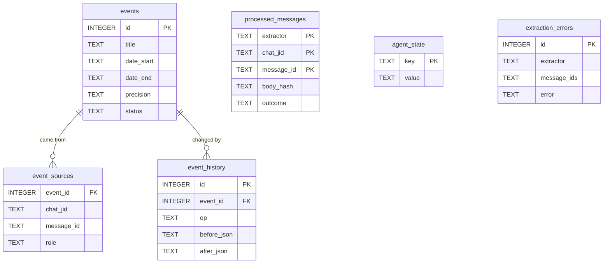

# Memory database

This document describes what seth-agent remembers and how it's stored: the tables, the rules for writing to them, and SQL you can run against them. For the HTTP API built on top of this, see [API.md](API.md). For the code, see the [development guide](DEVELOPMENT.md).

The source of truth is [src/seth_agent/memory/schema.sql](../src/seth_agent/memory/schema.sql). The read and write logic is in [src/seth_agent/memory/store.py](../src/seth_agent/memory/store.py).

## Overview

| Store | Location | Owner | Contents |
|---|---|---|---|
| Memory database | `data/memory.db` (`SETH_MEMORY_DB`) | seth-agent | the calendar, plus the agent's own bookkeeping |
| Message database | `seth-ingestion/data/messages.db` (`SETH_SOURCE_DB`) | seth-ingestion | the raw WhatsApp messages. seth-agent **only reads** it. See seth-ingestion's [DATABASE.md](../../seth-ingestion/docs/DATABASE.md) |

The memory database is SQLite in WAL mode. The agent creates it on first run and brings the schema up to date on every start. You can read it with `sqlite3` while the agent is running.

The tables fall into two groups:



- **Memory** (`events`, `event_sources`, `event_history`) is what the agent knows. Each kind of memory gets its own tables, and the calendar is the first.
- **Bookkeeping** (`processed_messages`, `agent_state`, `extraction_errors`) is how the agent keeps track of its own progress. It's shared by every extractor.

## Conventions

- **Dates** are `YYYY-MM-DD` strings in the agent's local timezone (`SETH_TZ`). They sort correctly as text.
- **Timestamps** are RFC3339 strings in UTC, such as `2026-10-12T17:02:31Z`, the same as in seth-ingestion.
- **Messages are identified** by `(chat_jid, message_id)`, the primary key of seth-ingestion's `messages` table. The memory database has no foreign keys into `messages.db`, because they're separate files.
- **Nothing is deleted.** A cancelled event stays, with `status = 'cancelled'`, so the history is always complete.

## Calendar tables

### `events`

One row per event the agent knows about.

| Column | Type | Null? | Description |
|---|---|---|---|
| `id` | INTEGER | no | **Primary key** |
| `title` | TEXT | no | Short name from the user's point of view, e.g. `Dad's flight` |
| `details` | TEXT | yes | One sentence of extra context |
| `date_start` | TEXT | no | First day of the event's span, inclusive |
| `date_end` | TEXT | no | Last day of the event's span, inclusive |
| `precision` | TEXT | no | `day`, `range`, `week`, `month` or `year`. See [Fuzzy dates](#fuzzy-dates) |
| `time` | TEXT | yes | Time of day as free text, e.g. `15:30` or `evening` |
| `status` | TEXT | no | `active` or `cancelled` |
| `confidence` | REAL | yes | 0–1, Claude's estimate that this is a real future event with the right date |
| `created_at` | TEXT | no | When the row was created |
| `updated_at` | TEXT | no | When the row last changed |

Index `idx_events_dates` on `(status, date_start, date_end)` serves range queries.

### Fuzzy dates

Every event is stored as a span of days, however precisely its date is known. `precision` records how exact it is:

| `precision` | Meaning | How the span is filled in |
|---|---|---|
| `day` | a single known day | `date_end = date_start` |
| `range` | a known start and end | both given explicitly |
| `week` | some time in a week | `date_start` is the first day of the week (the prompt asks for the Monday), `date_end` is 6 days later |
| `month` | some time in a month | the 1st to the last day of that month |
| `year` | some time in a year | January 1 to December 31 |

`MemoryStore` fills in the span from `precision` itself, in `normalize_span`, so it is always consistent with `precision` whatever Claude returns. This makes every range query the same overlap test, whatever the precision:

```sql
WHERE date_start <= :to AND date_end >= :from
```

### `event_sources`

The messages behind each event. One message can support several events, and one event can be supported by several messages.

| Column | Type | Null? | Description |
|---|---|---|---|
| `event_id` | INTEGER | no | **Foreign key** to `events.id`, `ON DELETE CASCADE` |
| `chat_jid` | TEXT | no | The message's chat, from seth-ingestion |
| `message_id` | TEXT | no | The message's WhatsApp id, from seth-ingestion |
| `role` | TEXT | no | `created`, `updated` or `cancelled`: what this message did to the event |

The primary key is all four columns. `idx_event_sources_message` on `(chat_jid, message_id)` answers the question "which events came from this message?". The agent uses it to handle edits and replies.

### `event_history`

An audit trail with one row per change.

| Column | Type | Null? | Description |
|---|---|---|---|
| `id` | INTEGER | no | **Primary key**, in order of change |
| `event_id` | INTEGER | no | **Foreign key** to `events.id` |
| `op` | TEXT | no | `add`, `update` or `cancel` |
| `before_json` | TEXT | yes | The full `events` row before the change, as JSON. `NULL` for `add` |
| `after_json` | TEXT | yes | The full `events` row after the change, as JSON |
| `reason` | TEXT | yes | Claude's explanation of why the messages led to this change |
| `at` | TEXT | no | When the change was made |

## Bookkeeping tables

### `processed_messages`

The messages each extractor has handled. This table is how the agent avoids reading a message twice, and how it notices a message that changed.

| Column | Type | Null? | Description |
|---|---|---|---|
| `extractor` | TEXT | no | The extractor's name, e.g. `calendar`. **Primary key** with the next two columns |
| `chat_jid` | TEXT | no | |
| `message_id` | TEXT | no | |
| `body_hash` | TEXT | no | The first 16 hex digits of the SHA-256 of the message body when it was handled |
| `outcome` | TEXT | no | `skipped` (filtered out without calling Claude), `extracted` (Claude read it) or `failed` (given up on) |
| `processed_at` | TEXT | no | When this happened |

A message is handled again only when its current body hash differs from the stored one. In practice this happens when seth-ingestion fills in an album's caption after the album was first stored.

Rows are per extractor, so a newly added extractor sees every message as new and works through the whole history, without affecting the others.

### `agent_state`

Key/value pairs.

| Key | Value |
|---|---|
| `source.high_water` | The newest `ingested_at` the agent has fully handled. The next poll reads from 10 minutes before this |
| `agent.last_poll_at` | When the last poll finished |
| `agent.last_transient_error` | `<timestamp> <extractor>: <message>` for the last problem that will be retried |

### `extraction_errors`

Batches an extractor gave up on, so you can review them.

| Column | Type | Description |
|---|---|---|
| `id` | INTEGER | **Primary key** |
| `extractor` | TEXT | Which extractor failed |
| `message_ids` | TEXT | JSON array of `[chat_jid, message_id]` pairs in the batch |
| `error` | TEXT | What went wrong, e.g. `refusal: …` or `400: …` |
| `at` | TEXT | When |

## Write rules

- **One transaction per batch.** An extractor's changes to memory and the `processed_messages` rows for that batch are committed together. If the agent crashes in between, the batch is simply processed again.
- **Changes go through `MemoryStore`.** `add_event`, `update_event` and `cancel_event` each write the event, its `event_sources` row and an `event_history` row together. Don't write to these tables directly, or the history will have gaps.
- **Updates merge.** `update_event` keeps any field the update doesn't mention. One exception: a new `date_start` without a `date_end` resets the end, so moving a 3-day range to a single day doesn't leave the old end behind.
- **An update reactivates.** Updating a cancelled event sets it back to `active`. For example, "actually the party is back on" restores the party.

## Example queries

Run these with `sqlite3 -header -column data/memory.db "<query>"`.

Upcoming events:

```sql
SELECT id, date_start, date_end, precision, title, time
FROM events
WHERE status = 'active' AND date_end >= date('now', 'localtime')
ORDER BY date_start;
```

Everything in November 2026, including month-precision events:

```sql
SELECT id, precision, date_start, date_end, title
FROM events
WHERE status = 'active' AND date_start <= '2026-11-30' AND date_end >= '2026-11-01'
ORDER BY date_start;
```

An event's full story:

```sql
SELECT op, reason, at,
       json_extract(before_json, '$.date_start') AS was,
       json_extract(after_json,  '$.date_start') AS now
FROM event_history WHERE event_id = 3 ORDER BY id;
```

Each event with the text of the messages behind it (attach seth-ingestion's database first):

```sql
ATTACH '/Users/tnpbot/github.com/seth-ingestion/data/messages.db' AS src;
SELECT e.id, e.title, s.role, m.sent_at, m.body
FROM events e
JOIN event_sources s ON s.event_id = e.id
JOIN src.messages m USING (chat_jid, message_id)
ORDER BY e.id, m.sent_at;
```

What happened to each message:

```sql
SELECT outcome, COUNT(*) FROM processed_messages WHERE extractor = 'calendar' GROUP BY outcome;
```

Batches that failed:

```sql
SELECT at, error, message_ids FROM extraction_errors ORDER BY id DESC LIMIT 10;
```

## Resetting

| To… | Do this (with the agent stopped) |
|---|---|
| Rebuild everything from scratch | Delete `data/memory.db` (and `-wal`/`-shm` if present) |
| Re-read every message for the calendar, keeping nothing | `DELETE FROM event_history; DELETE FROM event_sources; DELETE FROM events; DELETE FROM processed_messages WHERE extractor = 'calendar'; DELETE FROM agent_state WHERE key = 'source.high_water';` (the `sqlite3` shell doesn't enforce foreign keys, so the child tables have to be cleared explicitly) |
| Retry batches that failed | `DELETE FROM processed_messages WHERE outcome = 'failed'; DELETE FROM agent_state WHERE key = 'source.high_water';` |

Clearing `source.high_water` makes the next poll look at the whole message history again. Only messages without a matching `processed_messages` row are sent to Claude, so the extra cost is a local read.

## Changing the schema

- **New tables or indexes:** add them to `schema.sql` with `IF NOT EXISTS`. They're created on the next start.
- **New columns on existing tables:** `CREATE TABLE IF NOT EXISTS` won't add them to a database that already exists. Add an `ALTER TABLE … ADD COLUMN` step to `MemoryStore.__init__`, guarded by a check of `pragma_table_info`, as seth-ingestion does in its `migrate`. Once there are several such steps, switch to numbered migrations keyed on `PRAGMA user_version`.
- **Tests:** add a case to [tests/test_store.py](../tests/test_store.py).
